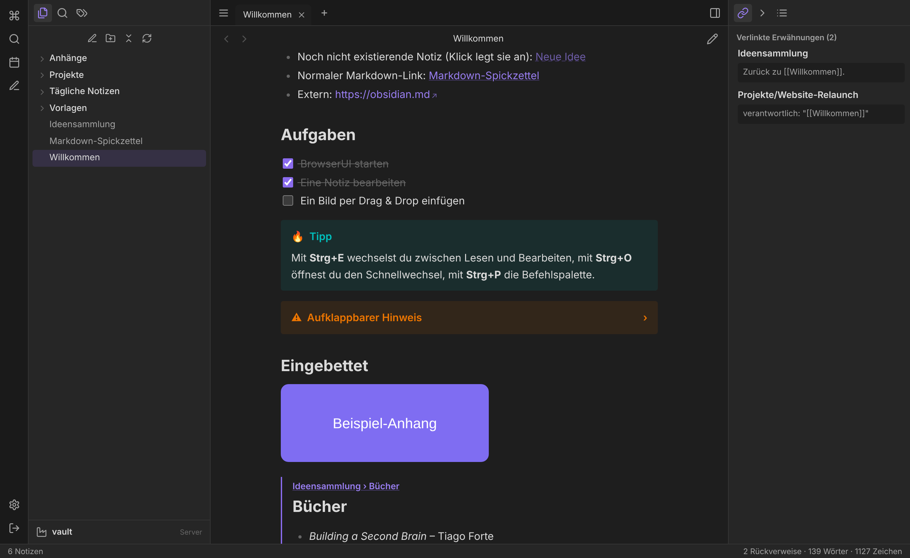
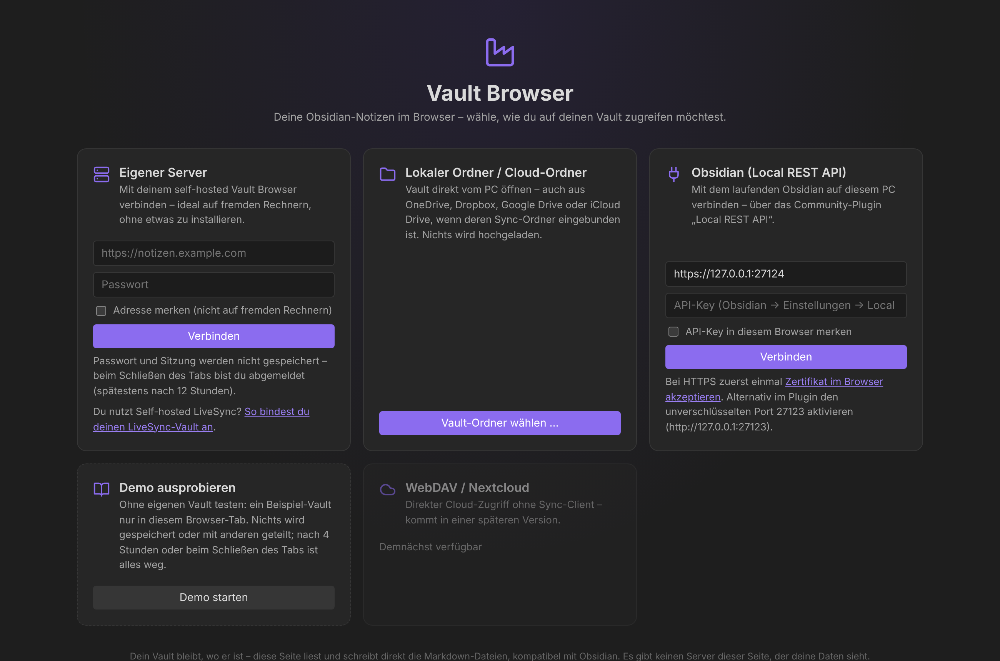

# Vault Browser

**Obsidian-Vaults im Browser lesen und bearbeiten – ohne Installation, auch auf fremden Rechnern.**

Vault Browser öffnet deinen [Obsidian](https://obsidian.md)-Vault direkt im Browser: aus einem lokalen Ordner, von deinem eigenen Server oder aus dem laufenden Obsidian. Die Oberfläche ist an Obsidian angelehnt und arbeitet direkt auf deinen Markdown-Dateien – Wikilinks, Embeds, Callouts, Aufgaben, Eigenschaften und Rückverweise funktionieren wie gewohnt, und Obsidian kann parallel auf denselben Vault zugreifen.

👉 **Direkt nutzen:** https://atoxien.github.io/obsidian-browserui/



> Unabhängiges Community-Projekt – nicht verbunden mit Obsidian / Dynalist Inc.

## Wege zum Vault

| Weg | Wofür | Voraussetzung |
| --- | --- | --- |
| **Eigener Server** | Von jedem Laptop an deine Notizen: Seite öffnen, Server-Adresse + Passwort eingeben, fertig | Self-hosted Server (siehe unten), per HTTPS erreichbar |
| ↳ **mit Self-hosted LiveSync** | Dein Vault wird per LiveSync (CouchDB) synchronisiert? Dann bindet der Server ihn über die offizielle livesync-bridge an – Änderungen landen auf allen Obsidian-Geräten | [Anleitung: docs/livesync.md](docs/livesync.md) |
| **Lokaler Ordner** | Vault direkt vom PC öffnen – auch aus **OneDrive, Dropbox, Google Drive, iCloud**, wenn deren Sync-Ordner eingebunden ist. Es wird nichts hochgeladen. | Chrome, Edge oder Brave (Firefox/Safari: nur lesen) |
| **Obsidian Local REST API** | Mit dem laufenden Obsidian auf diesem PC verbinden | Community-Plugin [Local REST API](https://github.com/coddingtonbear/obsidian-local-rest-api) |
| **Demo** | Ausprobieren ohne eigenen Vault | nichts |
| WebDAV / Nextcloud | *geplant* | |

Jeder Besucher arbeitet nur mit **seiner eigenen** Quelle. Die Seite selbst speichert keine Notizen, Zugänge oder Nutzerdaten. Du kannst also mit deinem Server arbeiten, während jemand anderes gleichzeitig die Demo ausprobiert – ohne deinen Vault zu sehen.

### Demo

„Demo ausprobieren“ öffnet einen Beispiel-Vault, der **nur im aktuellen Browser-Tab** existiert. Alles lässt sich bearbeiten, aber nichts wird an einen Server geschickt oder mit anderen geteilt. Die Demo wird **nach 4 Stunden automatisch zurückgesetzt**, beim Schließen des Tabs ist sie weg, und sie lässt sich jederzeit über „Jetzt zurücksetzen“ leeren.

Die Oberfläche gibt es auf zwei Arten – beides ist dieselbe App:

1. **Gehostet auf GitHub Pages** (Link oben): nichts installieren. Die Seite ist rein statisch, deine Notizen gehen nur zwischen deinem Browser und deiner Quelle (Ordner, eigener Server, Obsidian) hin und her.
2. **Self-hosted**: der Server liefert die Oberfläche gleich mit aus (`https://dein-server/`). Dann erscheint auf der Startseite direkt „Server-Vault“.



### Auf fremden Rechnern

- Beim Weg „Eigener Server“ wird **kein Cookie und kein Passwort gespeichert**. Die Sitzung gilt nur im aktuellen Tab und läuft spätestens nach 12 Stunden ab; offene Notizen und Ordnerzustand liegen nur im Sitzungsspeicher des Tabs.
- „Adresse merken“ nicht ankreuzen.
- Nach Benutzung unten links **„Vault wechseln / abmelden“** wählen oder den Tab schließen.

## Funktionen

- Dateibaum mit Ordnern, Kontextmenü, Drag & Drop (verschieben, Dateien hochladen)
- Tabs, Zurück/Vor, Sitzung wird gemerkt, Deep-Links (`/#/Ordner/Notiz.md`)
- **Leseansicht** und **Bearbeiten** (CodeMirror 6), Umschalten mit `Strg+E`, Auto-Speichern
- Obsidian-Markdown: `[[Wikilinks|Alias]]`, `[[Notiz#Überschrift]]`, `[[Notiz#^block]]`, Embeds `![[Bild.png|300]]` / `![[Notiz#Abschnitt]]` / PDF / Audio / Video, `#tags/verschachtelt`, Callouts (`> [!tip]`, faltbar mit `+`/`-`), Aufgaben (anklickbar), `==Hervorhebung==`, `%%Kommentare%%`, Mathe mit KaTeX, Frontmatter als **Eigenschaften**, Aliase
- Link-Auflösung wie Obsidian (kürzester Pfad), Klick auf fehlenden Link legt die Notiz an
- **Rückverweise**, unverlinkte Erwähnungen, ausgehende Links, Gliederung, Tag-Übersicht
- Volltextsuche (`tag:#x`, `path:ordner`, `file:name`, `"Phrase"`, `-ausschließen`)
- Schnellwechsel (`Strg+O`), Befehlspalette (`Strg+P`), Autovervollständigung für `[[` und `#`
- Umbenennen/Verschieben **aktualisiert Links** in anderen Notizen
- Liest `.obsidian/app.json`, `daily-notes.json`, `templates.json`: Tagesnotiz mit Vorlage, Vorlagen einfügen, Anhang-Ordner für eingefügte Bilder (Einfügen/Drag & Drop in den Editor)
- Löschen verschiebt in `.trash` (wie Obsidian)
- Konflikterkennung: wurde eine Datei extern (z.B. in Obsidian) geändert, wird nicht stillschweigend überschrieben; Änderungen von außen erscheinen live (Server-Modus)
- Hell/Dunkel, mobil nutzbar

### Tastenkürzel

| Kürzel | Aktion |
| --- | --- |
| `Strg+O` | Schnellwechsel / Notiz erstellen |
| `Strg+P` | Befehlspalette |
| `Strg+E` | Lesen ↔ Bearbeiten |
| `Strg+N` | Neue Notiz |
| `Strg+S` | Speichern (passiert sonst automatisch) |
| `Strg+Umschalt+F` | Suche |
| `F2` | Umbenennen |
| `Alt+←` / `Alt+→` | Zurück / Vor |
| `Alt+W` | Tab schließen |
| Strg+Klick auf Link | In neuem Tab öffnen (im Editor: Link folgen) |
| `Strg+L` (Editor) | Aufgabe umschalten |

## Installation (Self-hosted)

### Docker Compose

Ein fertiges Image wird bei jedem Push auf `main` gebaut: `ghcr.io/atoxien/obsidian-browserui` (amd64 + arm64, läuft also auch auf Raspberry Pi/NAS).

```yaml
services:
  vault-browser:
    image: ghcr.io/atoxien/obsidian-browserui:latest
    restart: unless-stopped
    ports:
      - "8080:8080"
    environment:
      VAULT_PASSWORD: "dein-passwort"
      SESSION_SECRET: "zufälliger-langer-wert"
      SECURE_COOKIE: "1"                              # hinter HTTPS
      ALLOWED_ORIGINS: "https://atoxien.github.io"    # Adresse der Oberfläche, die du nutzt (Pages des Projekts oder deines Forks)
    volumes:
      - /pfad/zu/deinem/vault:/vault
```

```bash
docker compose up -d
```

Dann `http://<server>:8080` öffnen (oder über die GitHub-Pages-Seite verbinden). Der Container läuft als Benutzer `node` (UID 1000) – der Vault-Ordner muss für diese UID beschreibbar sein.

### Ohne Docker

```bash
npm ci
```

```bash
npm run build
```

```bash
VAULT_PATH=/pfad/zum/vault VAULT_PASSWORD=geheim npm start
```

### Konfiguration

| Variable | Standard | Bedeutung |
| --- | --- | --- |
| `VAULT_PATH` | – | Pfad zum Vault (Pflicht) |
| `VAULT_PASSWORD` | – | Login-Passwort (Pflicht, außer `NO_AUTH=1`) |
| `SESSION_SECRET` | zufällig | Signatur der Login-Cookies; setzen, damit Logins Neustarts überleben |
| `SECURE_COOKIE` | `0` | `1` = Cookie nur über HTTPS (hinter Reverse-Proxy empfohlen) |
| `PORT` / `HOST` | `8080` / `0.0.0.0` | |
| `ALLOWED_ORIGINS` | – | Kommagetrennte Adressen (ohne Pfad) der Oberflächen, die diesen Server nutzen dürfen – z.B. `https://atoxien.github.io` für die offizielle Pages-Seite oder `https://<dein-user>.github.io` für deinen Fork. Nur nötig, wenn die Oberfläche nicht von diesem Server selbst kommt. |
| `NO_AUTH` | – | `1` = ohne Passwort (nur für lokale Tests!) |

### Sicherheit

- **Immer hinter HTTPS betreiben**, wenn der Server aus dem Internet erreichbar ist (z.B. Caddy, Traefik, nginx; oder nur über VPN/Tailscale). Dann `SECURE_COOKIE=1` setzen.
- Login mit Rate-Limit, signiertem HttpOnly-/SameSite-Cookie, CSRF-Schutz über Pflicht-Header.
- Von fremden Herkünften (GitHub Pages) nur, wenn in `ALLOWED_ORIGINS` eingetragen; Anmeldung dann per kurzlebigem Token (12 h) statt Cookie.
- Für den Zugriff von GitHub Pages muss der Server per **HTTPS** erreichbar sein (Browser blockieren sonst den Zugriff von einer HTTPS-Seite). Chrome fragt ggf. einmal nach, ob die Seite auf Geräte im lokalen Netzwerk zugreifen darf.
- Dateizugriffe sind auf den Vault beschränkt (Schutz gegen `../` und Symlink-Ausbrüche).
- Gerendertes HTML wird mit DOMPurify bereinigt.

Beispiel Caddy:

```
notes.example.com {
  reverse_proxy localhost:8080
}
```

## Obsidian Local REST API

1. In Obsidian das Community-Plugin **Local REST API** installieren und aktivieren.
2. API-Key aus den Plugin-Einstellungen kopieren.
3. Im Vault Browser „Obsidian (Local REST API)“ wählen, URL `https://127.0.0.1:27124` und Key eintragen.
4. Das Plugin nutzt ein selbstsigniertes Zertifikat: einmal **„Zertifikat im Browser akzeptieren“** anklicken und bestätigen – oder im Plugin den HTTP-Port `27123` aktivieren.

Hinweis: Die REST-API kennt keine leeren Ordner und kein natives Umbenennen; Umbenennen erfolgt als Kopieren + Löschen.

## Entwicklung

```bash
npm ci
```

```bash
VAULT_PATH=examples/vault NO_AUTH=1 npm start
```

```bash
npm run dev
```

`npm run dev` startet Vite (Port 5173) und leitet `/api` an den Server auf Port 8080 weiter.

```bash
npm test
```

Aufbau:

```
server/   Fastify-Server: Vault-API, Login, Datei-Watch (SSE)
web/      Frontend (Vite + TypeScript, ohne Framework)
  src/adapters/   VaultAdapter: server, localfs, restapi, demo (WebDAV folgt)
  src/vault/      Index, Link-Auflösung, Backlinks, Suche, Frontmatter
  src/markdown/   markdown-it mit Obsidian-Erweiterungen
  src/ui/         Workspace, Editor, Lese-Ansicht, Dateibaum
examples/vault/   Beispiel-Vault (auch Inhalt der Demo)
deploy/livesync/  Compose + Bridge-Konfiguration für Self-hosted LiveSync
```

Neue Quellen (z.B. WebDAV) implementieren das Interface in `web/src/adapters/types.ts`.

GitHub Actions: `ci.yml` (Tests + Build), `pages.yml` (Veröffentlichung auf GitHub Pages bei Push auf `main`), `docker.yml` (Image nach `ghcr.io`).

## Lizenz

Siehe [THIRD_PARTY_NOTICES.md](THIRD_PARTY_NOTICES.md) für die verwendeten Bibliotheken. [livesync-bridge](https://github.com/vrtmrz/livesync-bridge) ist nicht enthalten, sondern wird beim Einrichten aus ihrem eigenen Repo gebaut.
